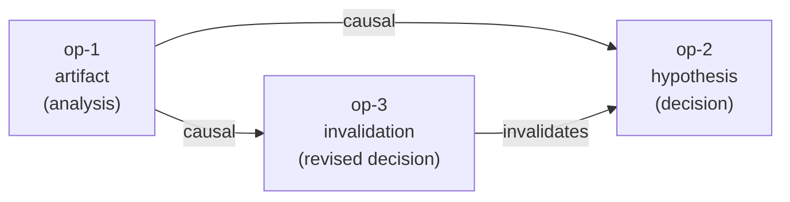

# History Graph Protocol (HGP)

[](LICENSE)
[](https://pypi.org/project/history-graph-protocol/)
[](https://github.com/wgsim/history-graph-protocol/actions/workflows/ci.yml)

**An MCP server that gives AI agents a permanent, append-only causal history.**

HGP records what an agent *did and why* — every file write, every decision, every piece of evidence behind each action. Where memory systems store what an agent *knows*, HGP stores what an agent *did*. Think of other memory systems as working memory; HGP is the audit trail.

---

## Why HGP?

| Without HGP | With HGP |
|---|---|
| Agent writes a file — no record of why | Every file write is a traceable artifact |
| Decision rationale lives only in context | Hypotheses and evidence are permanently stored |
| Can't tell what changed or when | Full causal graph: who did what, citing what |
| Session ends, history is gone | History persists across sessions and agents |

---

## Core Concepts

### Operations (Nodes)

Every action is an immutable, append-only record. Four types:

| Type | When to use |
|------|-------------|
| `artifact` | A produced output — file written, data generated |
| `hypothesis` | A decision, plan, or inference |
| `merge` | Combining multiple prior operations |
| `invalidation` | Superseding or retracting a prior operation |

Operations are never deleted or mutated. The graph only grows.

### Causal Graph (DAG)

Operations are connected by directed edges:

- **`causal`** — A produced B (B depends on A)
- **`invalidates`** — A supersedes B



### Memory Tier

Each operation has a memory tier that reflects access recency:

| Tier | Meaning |
|------|---------|
| `short_term` | Recently active; included in all queries |
| `long_term` | Older but still reachable; included in all queries |
| `inactive` | Not accessed recently; excluded from default queries, never deleted |

Tiers update automatically and can be set manually via `hgp_set_memory_tier`.

### Evidence Trail

Operations can cite other operations as evidence, independently of the DAG edge structure. Evidence relations carry:

- **relation** — `supports`, `refutes`, `context`, `method`, or `source`
- **scope** — which aspect of the citing op this evidence applies to
- **inference** — free-text explanation of how the evidence was used

Given any decision, you can reconstruct exactly what evidence it was based on and how each piece was interpreted.

---

## Installation

**Prerequisites:** Python ≥ 3.12

```bash
pip install history-graph-protocol
```

> The PyPI package is `history-graph-protocol`; the installed CLI command is `hgp`.

Verify the install before proceeding:

```bash
command -v hgp                                    # confirms hgp is on PATH
python -c "import hgp; print(hgp.__version__)"   # confirms the package is importable
```

If `command -v hgp` prints nothing, the package was installed in a Python environment whose `bin/` is not on your `PATH`. Activate the virtual environment first, then re-run the checks.

> If using a virtual environment, activate it first — all subsequent `hgp` commands must run in the same environment.

### One-command setup

```bash
hgp install
```

This registers HGP as an MCP server, installs hooks, and injects agent instructions — all in one step. Supports Claude Code, Gemini CLI, Codex, and Antigravity CLI (`agy`):

```bash
hgp install            # all supported clients (recommended); agy only if `agy` is on PATH
hgp install --claude   # Claude Code only
hgp install --gemini   # Gemini CLI only
hgp install --codex    # Codex only
hgp install --agy      # Antigravity CLI only (global scope only)
hgp install --local    # project-local scope instead of global
```

`hgp install` prints a step-by-step report. Each line starts with `✓` (success) or `✗` (skipped/failed):

```
Claude Code:
  ✓ MCP: registered
  ✓ hooks files: installed 3 file(s) → /Users/you/.claude/hooks
  ✓ hooks settings: updated
  ✓ instructions: injected
```

A `✗` line includes a reason (e.g. `claude CLI not found — skipping MCP registration`). All `✓` lines mean the install succeeded for that client.

**Verify config files were written** (no client restart needed for this check):

| Client | Hooks dir | MCP config written by |
|---|---|---|
| Claude Code | `~/.claude/hooks/` | `claude mcp add` (via CLI) |
| Gemini CLI | `~/.gemini/hooks/` | `gemini mcp add` (via CLI) |
| Codex | `~/.codex/hooks/` | `~/.codex/config.toml` |
| Antigravity CLI (`agy`) | `~/.gemini/config/hooks/`, registered in `~/.gemini/config/hooks.json` | `agy mcp add` (via CLI) |

For local scope (`--local`), paths are under `<repo_root>/.claude/`, `<repo_root>/.gemini/`, or `<repo_root>/.codex/` respectively. agy is global only: with `--local` the installer prints that agy is not supported yet and skips it.

**Restart your client** to load the newly registered MCP server. This requires human action — an AI agent cannot restart its own host process. After restarting, the HGP tools (`hgp_write_file`, `hgp_create_operation`, etc.) will appear in the tool list.

### Manual setup

> **Python path:** In all commands below, `python` must be the Python that has `history-graph-protocol` installed. Find the correct path with `python -c "import sys; print(sys.executable)"` (after activating your venv if applicable), then substitute it for `python` throughout.

<details>
<summary>Configure without hgp install</summary>

**Claude Code:**

```bash
claude mcp add --scope user hgp -- python -m hgp.server
```

**Gemini CLI:**

```bash
gemini mcp add --scope user hgp python -m hgp.server
```

**Antigravity CLI (`agy`):**

```bash
agy mcp add hgp python -m hgp.server
```

**Codex** — add to `.codex/config.toml`:

```toml
[mcp_servers.hgp]
command = "python"
args = ["-m", "hgp.server"]

[features]
codex_hooks = true   # enable lifecycle hooks (required for HGP hook support)
```

To also install hook files (`.codex/hooks/`) and `hooks.json`, run `hgp install --codex` instead. Manual config covers MCP registration and feature flag only. Currently Codex fires `PreToolUse`/`PostToolUse` hooks for Bash commands only; `apply_patch` (file edits) support is a [known upstream issue](https://github.com/openai/codex/issues/16732).

> Use the Python that has `history-graph-protocol` installed. If using a virtual environment, replace `python` with the absolute path to the venv Python (e.g. `/path/to/.venv/bin/python`).

</details>

---

## Quick Start

> These are MCP tool calls — invoke them through your MCP client (Claude Code, Gemini CLI, or any MCP-compatible host).

```text
# Write a file and record it as an artifact
hgp_write_file(
    file_path="src/analysis.py",
    content="...",
    agent_id="claude-code",
    metadata={"description": "Initial analysis script"},
)
# → returns op_id: "op-abc123"

# Record the decision that led to a follow-up file
decision = hgp_create_operation(
    op_type="hypothesis",
    agent_id="claude-code",
    metadata={"description": "Refactor to use async based on profiling results"},
    parent_op_ids=["op-abc123"],
)

# Write the refactored file, linked to the decision
hgp_write_file(
    file_path="src/analysis.py",
    content="...",
    agent_id="claude-code",
    parent_op_ids=[decision["op_id"]],
)

# Later: audit what happened to a file
hgp_file_history(file_path="src/analysis.py")
# → all HGP operations recorded for this file, in order
```

---

## Tool Index

### File tools

| Tool | Description |
|------|-------------|
| `hgp_write_file` | Write (create or overwrite) a file and record it as an artifact |
| `hgp_append_file` | Append content to a file and record as artifact |
| `hgp_edit_file` | Replace a unique string in a file and record as artifact |
| `hgp_delete_file` | Delete a file and record an invalidation operation |
| `hgp_move_file` | Move/rename a file; records invalidation of old path + new artifact |
| `hgp_file_history` | Return all HGP operations recorded for a given file path |

### Graph tools

| Tool | Description |
|------|-------------|
| `hgp_create_operation` | Record a new operation; optionally attach payload, link parents, cite evidence |
| `hgp_query_operations` | Filter operations by type, agent, status, or memory tier |
| `hgp_query_subgraph` | Traverse ancestors or descendants from a root operation |
| `hgp_get_evidence` | List all operations a given op cited as evidence |
| `hgp_get_citing_ops` | Reverse lookup — list all ops that cited a given op as evidence |
| `hgp_get_artifact` | Retrieve binary payload from CAS by its `object_hash` |
| `hgp_anchor_git` | Link an operation to a Git commit SHA (requires full 40-char lowercase hex SHA) |
| `hgp_set_memory_tier` | Manually set an operation's memory tier (`short_term`, `long_term`, `inactive`) |

### Lease tools

Leases provide optimistic locking for multi-step write sequences.

| Tool | Description |
|------|-------------|
| `hgp_acquire_lease` | Acquire a lock on a subgraph before multi-step writes |
| `hgp_validate_lease` | Check a lease is still active; extends TTL by default |
| `hgp_release_lease` | Release a lease explicitly after writing |

### Maintenance

| Tool | Description |
|------|-------------|
| `hgp_reconcile` | Run crash-recovery reconciler (use after unexpected shutdown) |

> **Token-sensitive sessions:** mutation tools accept `verbose=False` to omit `chain_hash` and `object_hash` from responses, reducing per-call token overhead by ~73%. Default is `verbose=True`.

→ Full API reference: [docs/tools-reference.md](docs/tools-reference.md)  
→ Usage patterns and examples: [docs/usage-patterns.md](docs/usage-patterns.md)

---

## Configuration

### HGP mode

Control whether HGP records operations. Mode is stored in `<repo_root>/.hgp/mode`. Agents are blocked from changing it via the `hgp mode` Bash command — the pre-Bash hook intercepts and rejects those calls.

```bash
hgp mode              # show current mode (default: on)
hgp mode on           # normal operation
hgp mode advisory     # mutation tools return HGP_ADVISORY instead of recording
hgp mode off          # all tools return HGP_DISABLED
```

| Mode | Mutation tools | Query tools |
|------|---------------|-------------|
| `on` | execute normally | execute normally |
| `advisory` | return `{"status": "HGP_ADVISORY"}` | execute normally |
| `off` | return `{"status": "HGP_DISABLED"}` | return `{"status": "HGP_DISABLED"}` |

### Hook enforcement policy

Hooks warn (or block) when native file tools are used instead of HGP equivalents.

```bash
hgp hook-policy              # show current policy (default: advisory)
hgp hook-policy advisory     # warn only — native file tools still allowed
hgp hook-policy block        # block native Write/Edit/MultiEdit/write_file/replace
```

> If you installed hooks before this feature was added, run `hgp install` again to update them.

In Claude Code, once a session has loaded or used HGP tools, the advisory policy asks you to approve each native `Write`/`Edit`/`MultiEdit` instead of only warning (the hook reads the session transcript for `mcp__hgp__*` tool use). The Claude hook has no `force_ask`, and it reads `HGP_HOOK_ASK` strictly: it asks only when the variable is unset or exactly `1`, and any other value (`0` included) keeps plain warnings. A `block` policy still blocks, and the hook stays silent while HGP is paused or not enabled.

**Antigravity CLI (`agy`).** `hgp install --agy` adds a named `hgp` hook to `~/.gemini/config/hooks.json` (any other named hook there is kept) and puts `pre_tool_use_hgp.py` and `hgp_paths.py` in `~/.gemini/config/hooks/`. agy hooks answer with decisions instead of warnings, so this hook has no advisory warning: with the default advisory policy it is silent unless the ask rule applies.

- Native file tools (`write_file`, `edit_file`, `write_to_file`, `replace_file_content`, `multi_replace_file_content`): `deny` under the `block` policy (or `HGP_HOOK_BLOCK=1`); otherwise a prompt once the session has called an HGP MCP tool (the hook reads agy's session transcript for a `call_mcp_tool` call to the `hgp` server); otherwise nothing. The prompt is `force_ask` by default: agy's plain `ask` honours its always-allow cache and its mode, so `--mode accept-edits` approved it without showing it, while `force_ask` always asks. `HGP_HOOK_ASK` (environment of the hook process only) picks it:

  | `HGP_HOOK_ASK` | agy hook decision |
  |---|---|
  | unset, `1` or `force` | `force_ask` (the default; `1` stays accepted for compatibility) |
  | `ask` | `ask` (honours the always-allow cache and mode) |
  | `0` | no prompt (silent) |
  | anything else (`yes`, `false`, empty, `ASK`, a typo, ...) | `force_ask`: an unknown value fails toward prompting |

  Values are case-sensitive. `deny` under `block` and the silence while HGP is paused or not enabled do not depend on `HGP_HOOK_ASK`.
- `run_command`: a command that runs HGP's mode or hook-policy command, or that writes `.hgp/mode` or `.hgp/hook-policy`, is always denied, even while HGP is paused. Quotes and backslashes are stripped before matching, and when the command uses `$` or a backtick the two words only have to appear somewhere in it (otherwise they must be adjacent); `python -m hgp.server <mode>` counts like `hgp <mode>`. This is a simple heuristic, not a shell parser, and nothing else is skipped, not even a commit message: a regex that removed text could be made to hide a real command. **Known false deny:** a commit message that mentions both words, such as `git commit -m "$(cat <<EOF ... hgp ... mode ... EOF)"`, is denied. Write the message to a file and run `git commit -F <file>` instead. A command that names `.hgp/mode` or `.hgp/hook-policy` fails closed: it is denied if a redirect (`>`, `>>`, `2>`, `&>`, `>|`, anywhere in the command) targets one of them, or if the command contains any writer word anywhere (`cp`, `mv`, `rm`, `tee`, `touch`, `ln`, `install`, `truncate`, `chmod`, `patch`, `git checkout/restore/reset/apply`, `dd`, `find -delete/-exec`, `git --output`, ...; any `sed` or `perl` counts, whatever its options). Operands are not resolved, so `cp .hgp/mode /tmp/x` and `cat .hgp/hook-policy | tee log.txt` are denied too. Only reading the file, or redirecting some other file with no writer word (`grep x .hgp/mode > out.txt`), is allowed. Any other command that looks file-mutating is denied under `block` and ignored otherwise (no ask, as in Claude Code).
- Read-only commands (`ls`, `git status`, `grep`, `rg`, ...) are checked only for options that write or run another command: `find` with `-delete`, `-exec`, `-execdir`, `-ok`, `-okdir`, `-fprint`, `-fprint0`, `-fprintf` or `-fls`, `git ... --output`, `rg --pre`, and git's program-running options (`--upload-pack`, `--receive-pack`, `--exec`, `--ext-diff`, their abbreviations such as `--up` and `--rec`, `-c <key>=<value>` and `--config-env`; `--update*`, `--recurse-submodules` and `--extended-regexp` are not matched). Their other arguments are text, so `grep -rn install src` and `git log --grep=cp` are fine under `block`. A command counts as read-only if it starts with a read-only prefix and contains no `;`, `&`, `|`, newline, `$(`, backtick, `<(` or `>`; anything else, such as `ls && cp a b`, gets every pattern. `git fetch` and `git remote` are not read-only prefixes. Under `block`, `sed` with any option cluster holding `i` (`-i`, `-Ei`, `-i.bak`) or `--in-place`, and `perl` with such a cluster (`-pi`, `-i.bak`; not `-Mmodule` or `-Ilib`), are mutating commands.
- The file-based policy yields to a paused mode (advisory/off), while `HGP_HOOK_BLOCK=1` always wins, as in the other hooks. `.hgp/mode` and `.hgp/hook-policy` are files the agent could write, so only the environment variable is a trusted channel.
- The hook never returns `allow`, so agy's own permission checks still apply, and it fails open: any error means no output, which agy treats as "no opinion". It is silent when HGP is not enabled for the repository or while HGP is paused, and HGP's own `hgp_*` calls are never matched.
- agy ignores the Gemini CLI hooks in `~/.gemini/hooks/` and `settings.json`; they are separate and untouched. Restart agy after installing.

The policy is stored in `.hgp/hook-policy` as JSON (`{"block_mode": true}`; other keys are preserved when the CLI updates it). Legacy plain-text files containing `block` or `advisory` are still read; unrecognised content is treated as advisory. While any installed `pre_tool_use_hgp.py` (project-local or in `~/.claude`, `~/.gemini`, `~/.gemini/config/hooks`, `~/.codex`) predates the JSON format, `hgp hook-policy` keeps writing the plain-text format so those hooks still enforce it, and tells you to reinstall them.

### Enabling HGP per repository

HGP is opt-in per repository. Run this once inside the repository (or any of its linked worktrees):

```bash
hgp init     # creates .hgp/ and keeps it out of git via .git/info/exclude
```

Until then, HGP tools return `HGP_NOT_INITIALIZED` and never create `.hgp/`, and the installed hooks do nothing in that repository. A repository that already has `.hgp/` (from an earlier version) stays enabled, and so does a linked worktree that kept its own pre-upgrade `.hgp/`. To stop using HGP in a repository, delete `.hgp/` (this deletes its history). To pause it instead, run `hgp mode off` (or `advisory`): while HGP tools do not write files, the native-tool hooks stay silent and do not block, whatever `.hgp/hook-policy` says. An explicit `HGP_HOOK_BLOCK=1` still blocks: an agent can write `.hgp/mode` but not the hook's environment. Global mode (`HGP_GLOBAL_MODE`) is unaffected: HGP tools and hooks are active in every directory.

### Storage

HGP stores its database and content-addressable blobs in `<repo_root>/.hgp/` (gitignored). The server resolves the active checkout from the nearest `.git` directory at startup. When running inside a linked Git worktree, it keeps file-safety checks scoped to that worktree but shares internal storage with the main repository through Git's `commondir`.

- **Graph tools** (`hgp_create_operation`, queries, etc.): outside a git repository they use `<cwd>/.hgp/` only if it already exists; otherwise they return `HGP_NOT_INITIALIZED`. To use HGP outside git, set `HGP_PROJECT_ROOT` and run `hgp init`, or use `HGP_GLOBAL_MODE`.
- **File tools** (`hgp_write_file`, `hgp_edit_file`, etc.): always require a git repo or an explicit `HGP_PROJECT_ROOT`. Without one, they return `PROJECT_ROOT_NOT_FOUND`.

The `.hgp/` directory is reserved for HGP internals. File tools reject any path that contains a `.hgp` directory segment — including nested paths like `sub/.hgp/file.txt` — and return `HGP_INTERNAL_PATH`. This applies across all `.hgp/` directories in a project tree, which is intentional for monorepo and nested-repo layouts.

#### File identity

Tracked files are stored as **repo-relative paths** (relative to the checkout the file lives in), so the same file has one history across all worktrees of a repository. Tool responses still report absolute paths, resolved against the active checkout. Global mode (`HGP_GLOBAL_MODE`, one store spanning many repositories) keeps absolute paths.

Databases created by earlier versions are migrated once on server start (migration `v6_relative_file_keys`); when any row changes, the database is first copied to `.hgp/hgp.db.pre-v6-<timestamp>.bak`.

#### Linked Git worktrees

All worktrees of a repository share the main repository's `.hgp/` (database, blobs, `mode`, `hook-policy`, session context files). Git submodules are not merged: each keeps its own `.hgp/`.

If a linked worktree already contains its own `.hgp/hgp.db`, the server pauses before opening the shared database. Stop older HGP processes and run `hgp export <new-directory>` inside the worktree. Export and backup select its legacy database and blobs. Verify the snapshot, then move the entire worktree-local `.hgp/` to an archive outside the checkout. The next server call uses the main repository's history. Keep the archive for historical queries. Importing a snapshot replaces the destination history, so use a separate repository to inspect it. Backups and exports record the original root so pre-v6 file history remains queryable from the new checkout. Review any worktree-local hook policy before switching.

- **Provenance**: operations from a linked worktree carry `metadata.hgp_checkout` with the worktree ID, the path at the time of recording, and the branch (or null). The ID follows `git worktree move` and does not affect file identity. Operations from the main checkout are untagged. Older records with only a worktree path remain available in repository and file history. HGP does not attribute those records to a specific checkout because Git can reuse the path. If HGP cannot store a worktree's ID (for example, its `.git/worktrees/<name>` directory is read-only or holds a damaged `hgp-worktree-id`), mutating tools in that worktree return `WORKTREE_ID_UNAVAILABLE` until the cause is fixed; read-only tools keep working.
- **Queries**: `hgp_query_operations` returns the whole repository's history by default (`scope="repo"`); pass `scope="checkout"` to narrow to operations recorded from the active checkout. `hgp_file_history` returns a file's history from every worktree.
- **Reconcile**: each checkout reconciles only its own pending file operations. Pending operations of a worktree whose Git registration no longer exists are marked `STALE_PENDING` (reported as `pending_orphaned`).
- **Behaviour change**: a `.hgp/mode` inside a linked worktree is no longer read; set it from any checkout and it applies to all. A legacy `.hgp/hook-policy` left inside a worktree is still honoured for `block` (hooks block if either the shared or the worktree-local policy says so), so upgrading never silently drops enforcement.
- **Restore/import**: `hgp restore` and `hgp import` run inside a linked worktree replace history for every worktree, so they require `--shared` to confirm.
- **Hooks**: `hgp install` / `hgp install-hooks` also install `hgp_paths.py` next to the hook scripts. A hook file that differs from the bundled one is backed up as `<name>.bak-<timestamp>` before being replaced. List them with `hgp hook-backups [--local]`; delete older ones with `hgp hook-backups --prune [--keep N] [--dry-run]` (keeps the newest per hook file by default; only backups of HGP's own hook files are touched).

One server process is bound to one store.

### Environment variables

| Variable | Default | Description |
|----------|---------|-------------|
| `HGP_PROJECT_ROOT` | _(auto)_ | Override project root (default: nearest `.git` from cwd, then `cwd`) |
| `HGP_HOOK_BLOCK` | `0` | Set to `1` to block native file tool calls instead of warning |
| `HGP_HOOK_ASK` | _(unset)_ | Native-write prompt in a session that used HGP. Claude hook: asks only if unset or `1`, any other value keeps warnings. agy hook: unset/`1`/`force` give `force_ask`, `ask` gives `ask`, `0` disables, anything else gives `force_ask` |

---

## Run as MCP server

```bash
hgp
# or
python -m hgp.server
```

HGP uses stdio transport and is compatible with any MCP-compliant host.
