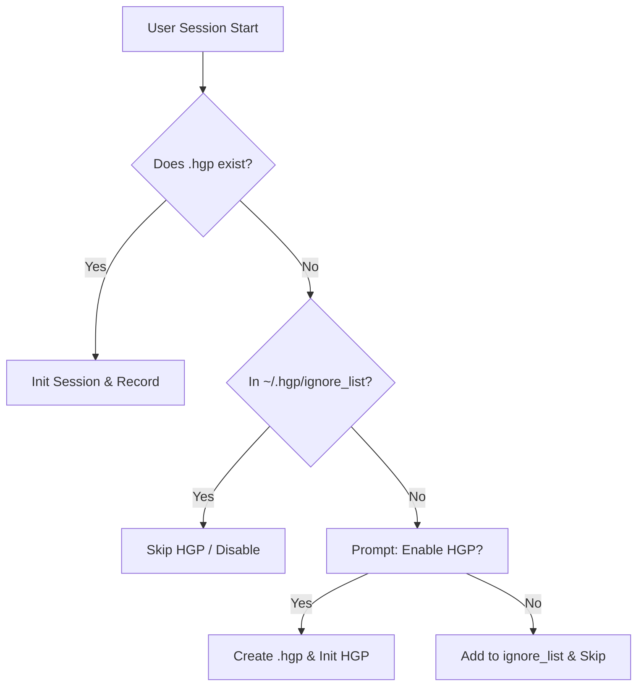

# Implementation Plan - Robust Git Worktree & Dynamic Project Isolation Support

This document outlines the design and implementation plan to natively support Git Worktrees and robustly isolate HGP-enabled projects from non-HGP projects on the same machine.

## Goal Description

Currently, when HGP is used within a Git Worktree, path resolution fails because HGP's path resolver and hooks do not recognize the `.git` pointer file created by Git Worktrees. This leads to false `CROSS_REPO_OPERATION` errors, fragmented `.hgp` database directories, and failure to load hook configurations.

Furthermore, in mixed-project environments, HGP's server and hooks may silently auto-create `.hgp/` directories in proprietary or non-HGP repositories where tracking is not desired.

This change accomplishes:
1. **Native Git Worktree Support**: Updates HGP's root and path resolution logic to recursively and correctly resolve Git Worktree pointer files to the canonical main repository, sharing a single source of truth database.
2. **Defensive Global Hook Architecture**: Introduces global hooks equipped with a zero-cost "Preflight Gate" and a robust `try-except` fail-open mechanism to eliminate performance overhead and completely isolate non-HGP projects without crashing.
3. **Interactive Smart Onboarding UX**: Enhances the AI agent's initial boot sequence to dynamically prompt the user to enable HGP on new repositories, storing rejections in a global `~/.hgp/ignore_list` to prevent prompt fatigue.

---

## User Review Required

> [!IMPORTANT]
> **Global Hook Migration**: Running `hgp install` will now register global hooks under `~/.claude/hooks` and `~/.gemini/hooks` instead of project-local directories. The installer will be updated to chain safely with any existing hooks without overwriting them.

> [!WARNING]
> **Concurrent SQLite Writes**: Sharing a single `.hgp/hgp.db` database file across multiple simultaneously active worktrees introduces concurrent write paths. While HGP's existing transaction model (`BEGIN IMMEDIATE`) handles concurrent SQLite writers safely, simultaneous active sessions will be officially limited to separate transaction serialization (meaning lock-waiting rather than graph fragmentation). We will add detailed integration tests to verify this under heavy load.

---

## Open Questions

> [!IMPORTANT]
> **Submodule Scoping Policy**: In Git Submodules, `.git` is also a pointer file pointing to the parent repository's `.git/modules/<name>` directory. 
> - *Proposed Strategy*: To preserve submodule boundary isolation, we propose to **not** merge submodule history into the parent repository's database. If HGP encounters a submodule pointer, it will resolve the submodule root directory as its own project root. 
> - *Do you agree with this submodule scoping policy?*

---

## Proposed Changes

We will modify HGP's path resolution module, update hook scripts to follow the defensive architecture, and enhance the onboarding prompt guidelines.



---

### Component: Core Path Resolution

We will update the core path resolver to understand Git Worktrees and Submodules cleanly and enforce rigorous path traversal boundaries.

#### [MODIFY] [project.py](../src/hgp/project.py)
* Refactor `find_project_root()` and path verification helpers:
  * **Strict Path Canonicalization & Containment Check**:
    * Any input path (relative or absolute) must be treated as untrusted.
    * **Non-existent Target Path Resolution**: For existing paths, resolve strictly using Python's `Path.resolve(strict=True)`. For non-existent files (new target paths), resolve the existing parent chain strictly (`Path.parent.resolve(strict=True)`), validate containment of the resolved parent directory against `working_tree_root`, and join the final leaf filename without requiring the leaf to pre-exist.
    * **Dual Canonicalization**: Store the active `working_tree_root` as an absolute, canonical path at session initialization. Before comparing containment, resolve the target file path (or its parent for new files) canonically as well.
    * **Prefix-Bypass Prevention (Boundary Check)**: Assert path containment using `os.path.commonpath([canonical_root, canonical_path]) == canonical_root` to prevent sibling directory bypasses.
    * **One Canonical File Identity Schema**: To ensure that cross-worktree history naturally converges, formally standardize on storing all tracked file paths in the HGP database as a **repo-relative path** (relative to the active `working_tree_root`). Do not key by `worktree_id`, as this would fragment file history across worktrees.
  * **Worktree Path Authority vs Storage Root Separation**:
    * Separate `storage_root` (the shared HGP database location, i.e. parent of the main `.git/` folder) from `working_tree_root` (the current active checkout directory).
    * Limit file mutations strictly to the active `working_tree_root` boundary, while merging and storing operation logs inside the shared `storage_root`.
  * **Symlink Escape Guard (`PATH_SYMLINK_ESCAPE`)**:
    * If a target path is inside the project root directory but resolves to a symlink pointing *outside* the root, mutating file operations must immediately fail and throw `PATH_SYMLINK_ESCAPE`.
    * **TOCTOU Symlink Race Hardening**: All mutating writes must use the atomic `os.O_NOFOLLOW` flag during file handles/open operations to fail atomically if a symlink swap occurs at execution time.
  * **Git Pointer Verification (Relative Traversals)**:
    * When a `.git` path is found:
      * If it is a directory: Return the parent directory (standard repository root).
      * If it is a file (pointer):
        * Read and parse the `gitdir: ...` declaration.
        * **Absolute Pointer Handling**: If the parsed `gitdir` is an absolute path, consume it as-is. If relative, resolve the `gitdir` path relative to the `.git` pointer file's parent directory and canonically verify it.
        * **Structural Path Component Matching**: Do not use fragile substring tests (`/modules/` or `/worktrees/`). Instead, inspect canonical path components strictly using `Path.parts`.
        * **Submodule Check**: A submodule is structurally detected if `'modules'` and `'.git'` are in the `gitdir_path.parts`. Treat the directory containing the `.git` file as the project root (submodule boundary). Do not merge submodule history into the parent database. Parent operations cannot traverse across submodule boundaries (`PATH_CROSSES_SUBMODULE_BOUNDARY`).
        * **Worktree Check**: A worktree is structurally detected if the parsed pointer directory resides within the main repository's `.git/worktrees/` directory:
          * Read the `commondir` file inside the resolved `gitdir` directory.
          * Parse and canonically resolve `commondir` (relative to `gitdir` if relative, or as-is if absolute) to locate the main `.git` directory, avoiding any directory traversals out of bounds.
          * The parent of the resolved main `.git` directory is the canonical main repository root. Return this as the HGP root.
        * Fall back gracefully to standard parent directory or throw `UNSUPPORTED_GIT_LAYOUT` if parsing fails.
* Ensure all paths are validated against this resolved canonical main repository root.

---

### Component: Defensive Global Hooks

We will rewrite the hook templates to be extremely lightweight, fail-open, and worktree-aware.

> [!IMPORTANT]
> **Defensive Security Boundary & Guarantees**
> - **Global Session Hooks (Advisory Observer Contract)**: These hooks act strictly as **best-effort, advisory observers**. Their job is to record environment context without interfering with the user's workflow. 
>   * **Zero-Latency Fail-Open**: If a hook encounters a locked database, missing `.hgp/` folder, permission error, or syntax crash, it must silently swallow the error and `sys.exit(0)`.
>   * **Telemetry Dead-Letter Logging**: On failure, the hook will append a single-line error summary to `~/.hgp/hook_errors.log`. To prevent locking or freezing in degraded environment mounts (e.g. NFS/SMB home dirs), this append **must** use raw OS-level unbuffered writes (`os.open` with `os.O_WRONLY | os.O_CREAT | os.O_APPEND | os.O_NONBLOCK`) wrapped in a strict, non-blocking `try...except` block with a short sleep-retry loop (3–5 attempts, 1ms sleep), falling back to silent discard after 10ms total execution time. If this append fails or times out, the error is swallowed and the hook exits 0 immediately.
>   * **Log Size Bounding & Rotation Trigger**: Growth of `hook_errors.log` (truncating it to a maximum of 1,000 lines or 1MB) is checked and rotated during *any* CLI command that reads from or interacts with the project root (such as `hgp status`, `hgp init`, or tool invocations).
> - **HGP Mutating Tools (Fail-Closed Contract)**: Standard file writing, editing, appending, and deleting tools (`hgp_write_file`, `hgp_edit_file`, etc.) must be **fail-closed**. If HGP is missing `.hgp/`, locked, or corrupt, these tools will raise explicit, typed exceptions (e.g. `HGP_NOT_INITIALIZED`) to prevent silent, untracked changes.

#### [MODIFY] [pre_tool_use_hgp.py](../src/hgp/hooks/claude/pre_tool_use_hgp.py)
* Remove all module-level execution (such as `BLOCK_MODE = _resolve_block_mode()`) to prevent import-time crashes.
* Wrap the entire `main()` function in a comprehensive `try...except Exception` fail-open guard.
* Ensure only lightweight Python standard library packages are imported (`sys`, `os`, `json`, `pathlib`).
* **Optimized Two-Step Check**:
  * Check 1: Verify if the resolved project root contains `.hgp/`. If missing, immediately `sys.exit(0)` (no-op).
  * Check 2: If `.hgp/` exists, read `.hgp/hook-policy` (a strict JSON schema: `{ "block_mode": false, "telemetry_enabled": true }` created during `hgp init`) to determine block/advisory settings.
* In the `except Exception` block, silently exit with `0` (fail-open) so the user's tool execution is never blocked.

#### [MODIFY] [pre_bash_hgp.py](../src/hgp/hooks/claude/pre_bash_hgp.py)
* Apply the same defensive structure and lightweight `try-except` fail-open wrapping.

#### [MODIFY] [pre_tool_use_hgp.py](../src/hgp/hooks/gemini/pre_tool_use_hgp.py)
* Port the exact same defensive `try-except` and lightweight two-step check structure to the Gemini CLI BeforeTool hook.

#### [MODIFY] [pre_bash_hgp.py](../src/hgp/hooks/gemini/pre_bash_hgp.py)
* Apply the same defensive structure.

---

### Component: Server Context Logic & SQLite Concurrency Model

We will modify the HGP server to prevent implicit database creation and robustly manage SQLite concurrency under multi-worktree environments.

#### [MODIFY] [server.py](../src/hgp/server.py)
* Refactor HGP server context initialization:
  * Do not automatically create the `.hgp/` directory upon server boot or generic tool execution.
  * If `.hgp/` is missing, return `HGP_DISABLED` or `NOT_INITIALIZED` immediately.
  * Only allow `.hgp/` creation inside explicit `hgp init` / enable CLI flows.
* Modify the `CROSS_REPO_OPERATION` check to allow files residing in separate Git Worktrees of the same common repository to share the same canonical HGP store.
* **SQLite Concurrency & Safety Controls**:
  * **WAL (Write-Ahead Logging) Mode**: Enable WAL mode during database connection initialization.
    * *NFS/SMB Preflight Write Test*: Some network filesystems fail only during actual write operations in WAL mode rather than the pragma command itself. HGP will execute a tiny write transaction immediately after requesting WAL mode (specifically, a single INSERT of a sentinel row into a reserved `__hgp_wal_test__` table, followed by an immediate ROLLBACK on success). If this write test fails or raises `sqlite3.OperationalError`, the connection will immediately fall back to Rollback Journal mode (`PRAGMA journal_mode=TRUNCATE`).
    * *Fallback Caching & 24-Hour Expiration*: Upon fallback, HGP will write a local diagnostic JSON cache file (`.hgp/nfs_mode` containing: `{ "journal_mode": "TRUNCATE", "timestamp": "ISO_TIMESTAMP", "project_root": "CANONICAL_PATH" }`) inside the `.hgp` directory. Subsequent connection bootstraps will check for this flag and bypass the WAL pragma attempt entirely. This cache will automatically expire and trigger a re-probe after 24 hours, if the project is relocated, or if manually cleared via HGP CLI.
  * **Transactional Safety**: Wrap all write operations (creating operations and recording edges) in atomic transactions using SQLite's `BEGIN IMMEDIATE` to prevent multi-worktree race conditions.
  * **C-Level Connection Queueing**: Set SQLite's native `PRAGMA busy_timeout = 2000` (2 seconds) to cleanly queue and serialize concurrent operations at the SQLite engine level before raising lock errors.
  * **Python Retry-with-Backoff Cap**: Use a jittered Python-level exponential backoff retry mechanism (capped at **1 second** total wait duration) only as a last-resort fail-closed guard for extended deadlocks that exceed the native 2-second SQLite timeout.
  * **SQL Identifier Allowlists**: Enforce strict compile-time white-lists (e.g. using `Tables` and `Columns` Python `Enum` values) for any dynamic SQL identifiers that cannot be parameterized.
* **CAS (Blob Storage) Concurrency & Atomicity**:
  * **Atomic Write-Replace Pattern**: All tracked blob/artifact file mutations in `.hgp_content/` must be written atomically.
    * *Same-Directory Temp Files & UUID Naming*: Write blobs to a temporary file named `[target_filename].hgp-[UUID]-temp` in the *exact same directory* as the target file, ensuring that the final `os.replace()` / `os.rename()` is a filesystem metadata atomic operation rather than a cross-device copy.
    * *Exclusive File Handles*: Open the temporary file using `os.open()` with `os.O_CREAT | os.O_EXCL | os.O_WRONLY` and tight permissions (`0o600` - readable only by owner) to prevent TOCTOU symlink races and unauthorized access.
    * *Permission Cloning & New File Fallbacks*: Copy the filesystem permissions (`os.chmod`) from the original file (if it exists) to the temporary file before the atomic rename. If it is a new file creation, use **`0o644`** (user read/write, group/other read) as the default fallback permission.
    * *Stale Temp File Cleanup*: Stale temp files matching `*.hgp-*-temp` that are older than 24 hours will be scanned and cleaned up during any routine HGP CLI execution.
* **Observability**:
  * Expose the active SQLite journal mode (WAL vs TRUNCATE) in `hgp status` to make file-system capability fallbacks transparent and easily inspectable.

---

### Component: System Prompt & Onboarding Guidelines

We will update the system rules injected into the agent's context and establish guardrails for the `ignore_list`.

#### [MODIFY] [GEMINI.md](~/.gemini/GEMINI.md)
* Insert the new **Interactive Opt-in & Onboarding** rule:
  * At the start of each session, the agent must check if `.hgp/` exists in the project root.
  * If `.hgp/` exists, immediately create a session root op and bind context.
  * If `.hgp/` is missing, check if the current project root absolute path exists in `~/.hgp/ignore_list`. If yes, completely skip HGP initialization and disable HGP for the session.
  * If absent from both, prompt the user: *"Would you like to enable HGP (History Graph Protocol) for this project to record your decisions and file changes? (Yes / No)"*.
    * If `Yes`: Automatically initialize HGP (create `.hgp/`, configure policy) and start recording.
    * If `No`: Append the project path to `~/.hgp/ignore_list` and disable HGP for the session.
* **Onboarding & ignore_list Guardrails**:
  * **Critical Path Exclusions**: Explicitly forbid adding critical system paths (such as `.git/`, `.hgp/`, Git Hook scripts, HGP configuration homes, or ancestor folders thereof) to the `ignore_list`.
  * **Case-Insensitive Filesystem Detection & Normalization**: Automatically detect case-insensitivity (using OS-specific checks, e.g. checking filesystem types via `pathconf` or executing a case-swapped write/read probe to a temporary file). On case-insensitive systems (like macOS/Windows), all paths written to or matched against `ignore_list` must be lowercase-normalized to prevent directory boundary bypasses due to case variance (e.g. `/Users/dev/` vs `/users/dev/`).
  * **Absolute Canonical Storage**: All paths stored in `ignore_list` must be canonical absolute project paths (resolved via `Path.resolve()`), de-duplicated, and normalized.
  * **Safe Concurrency, Windows Locking & Stale Overrides**: Writing or updating the `ignore_list` must utilize a non-blocking `fcntl.flock` (using `LOCK_EX | LOCK_NB` on Unix, or a fallback atomic lock file at `~/.hgp/ignore_list.lock` on Windows) with a short 50ms retry loop. The update itself must follow the write-to-temp + atomic rename pattern. On Windows, if `.hgp/ignore_list.lock` already exists, HGP will parse the recorded process ID (PID). If that PID is no longer running or active, the lock is safely overridden to prevent persistent deadlocks from crashed sessions. If locking fails after 50ms total, the boot sequence must fail-open to avoid hanging the terminal CLI session.

---

### Component: JSON Error Taxonomy

We will enforce a unified, typed JSON error response system across all HGP tools to allow calling AI agents to parse and adapt to failures cleanly.

* **Path & Boundary Errors**:
  * `PATH_OUTSIDE_PROJECT`: The requested file path resolves outside the active `working_tree_root`.
  * `PATH_CROSSES_SUBMODULE_BOUNDARY`: The path crosses into a registered Git Submodule, which is isolated from the parent repository's history graph.
  * `PATH_SYMLINK_ESCAPE`: A path resolves to a symlink pointing outside the safe project root boundary.
  * `PERMISSION_DENIED`: OS-level permission or access violations encountered when reading or writing target paths.
* **State & Initialisation Errors**:
  * `HGP_NOT_INITIALIZED`: Mutating file operations attempted on a repository without a `.hgp/` directory.
  * `GIT_ROOT_UNRESOLVED`: The HGP core resolver could not determine a valid git repository or worktree root.
  * `UNSUPPORTED_GIT_LAYOUT`: Encountered an invalid or corrupt git metadata structure.
* **Database & Lock Errors**:
  * `HGP_DB_LOCKED`: SQLite write concurrency limits exceeded after exponential backoff retries.
  * `HGP_DB_CORRUPT`: Database integrity checks failed during connection initialization or reconciliation.
  * `HGP_FS_UNSUPPORTED`: The local filesystem (e.g. degraded network drive) does not support necessary database transactional or rollback locks.
* **Integrity & Immutability Errors**:
  * `IMMUTABILITY_VIOLATION`: An attempt was made to overwrite or modify an existing immutable operation block in the DAG.
  * `INVALID_PARENT_OP`: A child operation referenced parent operation IDs that do not exist in the HGP database.
  * `HOOK_CAPTURE_FAILED`: The hook preflight encountered a critical failure (logged fail-open).

---

## Verification Plan

We will verify both correct path resolution under Git Worktrees and the defensive no-op behavior under non-HGP projects.

### Automated Tests
* Create a new test suite `tests/test_worktrees.py` verifying:
  * Path resolution of a mock Git Worktree `.git` file to its main repository root.
  * Submodule path resolution isolation (does not resolve to parent root).
  * Robust parsing of relative and absolute `gitdir:` pointers and `commondir` targets.
* Run the existing and new test suites:
  ```bash
  uv run pytest tests/
  ```
* Run type checking and linting to ensure no regressions:
  ```bash
  uv run pyright
  uv run ruff check
  ```

### Manual Verification
1. **Interactive Prompt Verification**:
   - Create a clean git repository without HGP.
   - Start an agent session and verify it asks "Would you like to enable HGP for this project? (Yes / No)".
   - Select "No" and confirm that HGP is disabled and the path is added to `~/.hgp/ignore_list`.
   - Start a second session and confirm that the agent skips HGP silently without prompting again.
2. **Git Worktree Verification**:
   - Create a Git Worktree from an HGP-enabled project.
   - Run HGP tools inside the worktree session and verify they write directly to the main repository's HGP database with no `CROSS_REPO_OPERATION` errors.